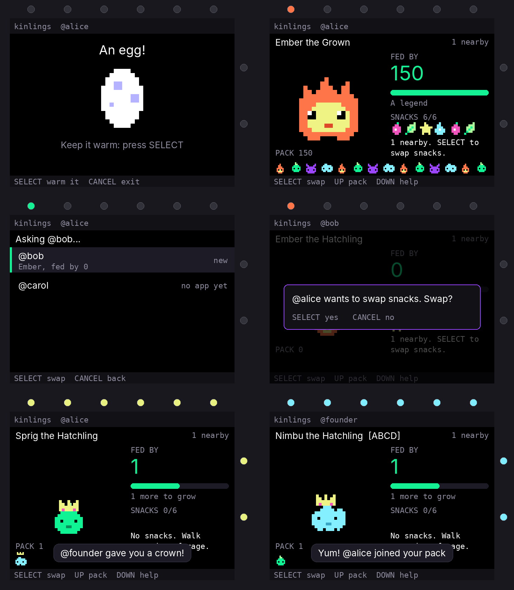

# Kinlings

A game for the Solana Breakpoint 2026 badge, hosted by ABCD. *Kinlings* is a
working title.

You raise a creature that only eats what other people give it.

- **Alone, you forage.** With the app open, your badge finds a snack near each
  new badge around you, whether or not that badge has the app.
- **Together, you swap.** Pick someone nearby who has the app open; they say
  yes, and you feed each other's creatures.
- **New people make it grow.** The first snack from each new person counts.
  The creature changes shape after 2 and 6 people, and keeps levelling after.
- **Everyone joins your pack.** The people you've met follow your creature
  along the bottom of the screen.
- **ABCD members hand out something to wear.** Swap with a member and your
  creature gets their item (a crown, a halo, a flower...). Members' minis wear
  a crown in your pack.



The picture is drawn by this repo's test rig, not by a badge: fonts and exact
positions differ on the real screen.

## Status

A first playable version. It has been run only in the test rig described
below, which uses the badge's own Lua and limits but imitates the screen and
radio. **It has not yet run in the official emulator or on a badge**, so
expect to find things there.

Placeholders to replace before an event:

- `app/data/members.txt` lists three made-up badge ids. It needs the real
  members' badge ids and the item each hands out. A badge's id is shown on
  the app's help screen (DOWN on the home screen).
- The creature art in `app/art/` is a first pass.
- The name and the `app.json` details.

## Try it

`app/` is the whole app, in the layout the badge App Store takes.

1. Open the badge site's submit page (`/apps/submit`) and drop the `app`
   folder on it.
2. **Try in emulator** runs it in the page. To see a swap, open the emulator
   in two tabs (`/emulator` and `/emulator?badge=2`), turn Wi-Fi on once in
   each so they get an id, and run the app in both.
3. **Run on badge** copies it to a real badge over USB (Solana OS 0.5.9 or
   later, for images).

Keys: SELECT swap, UP your pack, DOWN help, LEFT/RIGHT change what the
creature wears, CANCEL back or exit.

To get a feel for it without a badge, `python3 tools/web/build.py preview.html`
makes one page that runs the same files in a browser, with two badges that can
swap with each other. It uses a browser Lua and a drawn screen, and doesn't
enforce the badge's memory limit, so it shows how the game plays, not whether
it runs on a badge.

## How it's put together

A badge app gets 48 KB of memory, code included, so only what must always be
there is in `main.lua`. Everything else is loaded when needed and dropped.

| Path | What |
|---|---|
| `app/main.lua` | Saved state, the radio's hello, foraging, the half-second beat |
| `app/ui/*.lua` | One file a screen: `egg`, `home`, `share` (who to swap with), `pack`, `help` |
| `app/act/*.lua` | One-off actions: a swap's messages (`radio`, `answer`), what a swap does (`meet`), `wear` |
| `app/art/*.lua` | Pixel art as rows of characters: one file per creature stage, per hat |
| `app/data/members.txt` | ABCD members' badge ids and items |

Permissions: `mesh` (see nearby badges, talk to the same app on them) and
`led`. No server and no Wi-Fi are needed to play.

Limits worth knowing:

- A pack remembers 150 people. Past that, swaps still work but aren't added.
- The pack list shows the newest 40.
- The member list ships inside the app, so anyone can read which badge ids
  are members.
- Someone running altered code on their own badge can give their own creature
  anything. Nothing here is worth cheating for; a leaderboard or prizes would
  need a server that checks swaps.

## Tests

`tools/sim/` is a test rig: `badgesim.c` runs the app on Solana OS's own Lua
(32-bit numbers, 48 KB heap, 200,000 instructions per callback, the firmware's
JSON), and `sim.py` plays the screen, LEDs, buttons, clock and radio for any
number of badges.

```sh
git clone --depth 1 https://github.com/solana-foundation/solana-os ../solana-os
tools/sim/build.sh ../solana-os        # needs gcc with 32-bit support (gcc-multilib)
python3 tools/sim/test_game.py shots   # "shots": optional folder for screenshots
```

`test_game.py` covers hatching, foraging, swaps (accepted, declined,
one-sided, both asking at once), growing, ABCD items, half the radio messages
being lost, junk sent by another badge, a badge with no clock, a full pack,
and six badges swapping for a simulated half hour. It also reports memory:
about 29 KB held on the home screen when new and 35 KB with a full pack, in
the rig. A real badge's own share of the 48 KB will differ somewhat.
